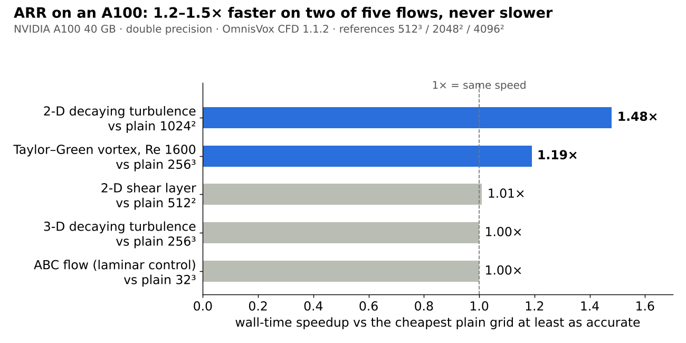

# OmnisVox CFD

**A pseudo-spectral Navier–Stokes solver that changes its grid resolution during a run, and rewinds and redoes any stretch it failed to resolve.** It never silently returns an under-resolved answer: it refines, or it flags the stretch.

2-D and 3-D, incompressible, periodic box. Runs on CPU (NumPy/SciPy) and NVIDIA GPUs (CuPy), with a desktop app (PySide6) and a command line.

## Results on an NVIDIA A100

Every run is scored against a fine reference (512³ in 3-D, 2048²/4096² in 2-D) and compared with **the cheapest plain (fixed) grid that is at least as accurate**, not just the finest one.

| Flow | Adaptive (ARR) vs | Speedup | Note |
|---|---|---|---|
| 2-D decaying turbulence, Re 5000 | plain 1024² | **1.48×** | dissipation history matches plain 1024² to 2×10⁻⁵ |
| Taylor–Green vortex, Re 1600 | plain 256³ | **1.19×** | lower error over the whole curve (1.9% vs 3.0%), but peak dissipation further off (1.7% vs 0.4%) |
| 2-D shear layer | plain 512² | 1.01× | already resolved on the coarsest grid; nothing to adapt |
| 3-D decaying turbulence | plain 256³ | 1.00× | needed the finest grid all run |
| ABC flow (laminar control) | plain 32³ | 1.00× | correctly never refined |

Also measured: 3-D single precision runs **1.9× faster** than double at 256³ with identical accuracy. All 12 GPU validation checks pass in both precisions. Full data, per-run histories and the notebook that produced them: [`benchmarks/a100/`](benchmarks/a100/).

### What didn't work, and limits

- **Gains are capped by the flow.** ARR saves only the time a flow can spend on a coarser grid. Taylor–Green needs 256³ for 82% of the run, so about 1.2× is the most any switching scheme can get there.
- **The GPU has a per-step floor.** On the A100 a step costs about 6 ms (3-D) or 3.3 ms (2-D) up to roughly 128³ or 1024², so coarse grids are cheap but not proportionally cheaper.
- **Local (spatial) refinement lost.** A fine patch over only the active region was less accurate and slower than whole-domain refinement on every case tested. It ships off by default and is documented in [`benchmarks/LOCAL_ARR_SMOKE.md`](benchmarks/LOCAL_ARR_SMOKE.md).
- **The benchmark found a bug, now fixed (1.1.2).** In 2-D turbulence, ARR originally lost (4× less accurate than plain 256², in the [quick run](benchmarks/a100/quick/SUMMARY.txt)). It had coarsened before the cascade began, and early under-resolution shifts later vortex mergers. ARR now steps down only while the signal is falling, and turbulent flows start on the finest grid.
- **Scope.** Periodic, incompressible flows: turbulence research and method development, not wall-bounded, compressible or complex-geometry engineering CFD.

## How it works

1. Every few steps the controller measures the **saturation pressure**: the share of enstrophy near the grid's smallest resolvable scale.
2. While that share is low, it keeps refreshing a clean checkpoint.
3. When it crosses a threshold, the controller **rewinds** to the last clean checkpoint, transfers the state exactly onto a finer grid, and recomputes the interval there.
4. It steps back down only when the coarser grid's share is low **and falling**.
5. If the finest grid still can't resolve the flow, that stretch is **flagged** in the output.

The numerics, the controller and what is and isn't validated: [`docs/METHOD.md`](docs/METHOD.md).

## Roadmap

- **Cut the GPU per-step overhead** (CUDA Graphs or fused kernels). Below about 128³ / 1024², each A100 step costs a fixed ~6 ms (3-D) or ~3.3 ms (2-D), which caps savings on small and medium grids.
- **Add a burst benchmark** (an impulsive start, for example), where fine resolution is needed only briefly. That's where adaptive resolution should pay off most, and none of the current five cases show it.
- **A better early-warning trigger for turbulent start-up**, so turbulent flows don't have to start on the finest grid by default.
- **A CuPy port of the local-refinement patch**, to test spatial refinement at large scale on the GPU.

## Windows quick start (no command line)

1. Install Python 3.10 or newer from https://www.python.org/downloads/windows/
   and tick **"Add python.exe to PATH"** in the installer.
2. Download this repository (green **Code** button → **Download ZIP**) and unzip it somewhere permanent (e.g. `Documents\OmnisVox`).
3. Double-click **`OmnisVox.bat`**. The first time, it installs everything it
   needs (a few minutes, needs internet); after that it opens straight away.

Want a real `OmnisVox.exe` you can copy to another PC without Python?
Double-click **`Build-OmnisVox-EXE.bat`** once. It builds
`dist\OmnisVox\OmnisVox.exe`, checks it, and makes `OmnisVox-windows.zip`.
The .exe runs on the CPU; for the GPU, use `OmnisVox.bat` with CuPy installed
(`.venv\Scripts\pip install cupy-cuda12x`).

## Install (command line)

Python 3.10 or newer.

    python -m venv .venv
    .venv\Scripts\activate            # Windows   (macOS/Linux: source .venv/bin/activate)
    pip install -e ".[desktop]"

For the GPU, add the CuPy wheel that matches your CUDA version, for example:

    pip install cupy-cuda12x

## Run

    omnisvox-cfd-desktop              # the app   (or: python -m omnisvox_desktop)
    omnisvox-cfd info                 # which backends are available
    omnisvox-cfd cases                # flows and their parameters
    omnisvox-cfd run --case taylor_green_3d --param Re=400 --preset "16^3 / 32^3 / 64^3" --out runs/tgv --frames 20
    omnisvox-cfd validate             # correctness checks (about a minute on a laptop CPU)
    omnisvox-cfd bench                # throughput per grid size

In the app: pick a flow, set its parameters and grid tiers, press **Start run**.
The right-hand panel records which grid was in use, every rollback, and the
unresolved share of the flow that drives those decisions. **File** exports the
image (PNG), fields (NPZ), history (CSV), volume (VTK for ParaView) and the run
summary (JSON). **Tools → Run validation suite** runs the correctness checks on
the selected device.

## Running on a GPU

Install the CuPy wheel matching your CUDA version (e.g. `pip install cupy-cuda12x`), then check it once:

    omnisvox-cfd validate --device gpu
    omnisvox-cfd validate --device gpu --precision single

On an NVIDIA A100 (CuPy 14, CUDA 13) all checks pass in both precisions.

## Reproduce the benchmark

Open [`benchmarks/a100/omnisvox_a100_benchmark.ipynb`](benchmarks/a100/omnisvox_a100_benchmark.ipynb) in Google Colab with an A100 runtime. It validates the GPU, measures throughput, runs every case (references, plain grids, ARR with and without rollback, both precisions), saves after every run, and writes the verdict table and charts. `MODE = "quick"` takes about 20 minutes; `"full"` takes several hours.

## Repository map

    omnisvox_cfd/        the engine: solvers, adaptive controller, cases, exports, CLI
    omnisvox_desktop/    the PySide6 desktop app
    tests/               pytest suite (pip install -e ".[dev]"; python -m pytest -q)
    benchmarks/a100/     A100 benchmark notebook, results and charts
    benchmarks/          CPU benchmark suite and the local-refinement study
    docs/METHOD.md       numerics, controller, validation and limits
    packaging/           Windows .exe build (see Build-OmnisVox-EXE.bat)

## License

Apache License 2.0; see [`LICENSE`](LICENSE). Copyright 2026 Robert E. Todd Jr. (OmnisVox Research).
