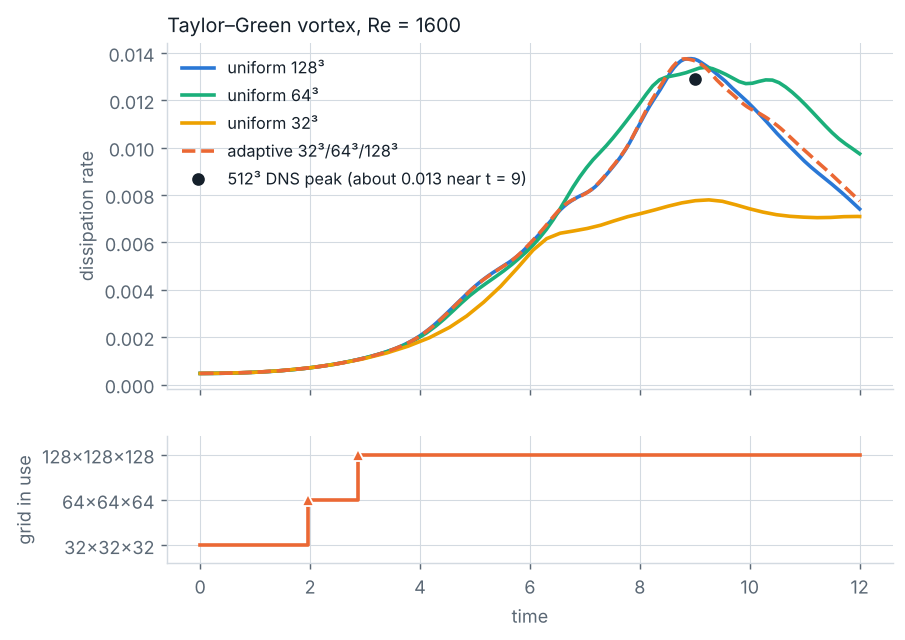
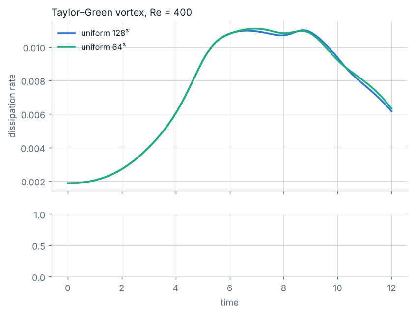
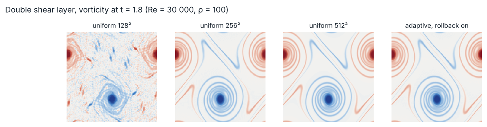
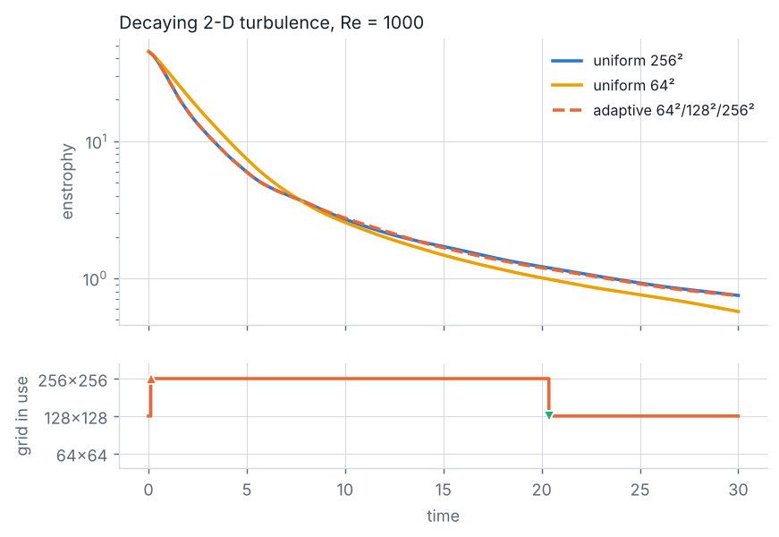
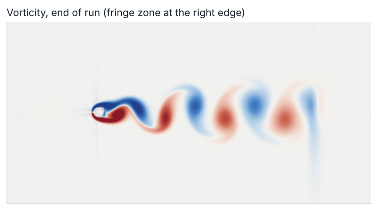
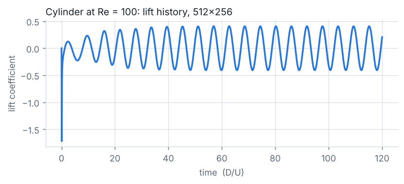

# OmnisVox CFD 1.0.0 — benchmark report

Everything below was run with `benchmarks/run_all.py` on **2 CPU threads, double
precision, NumPy/SciPy backend**. There was no GPU on the build machine, so no
GPU numbers appear here; run `python benchmarks/run_all.py --device gpu` to
produce them. Regenerate this file with `python benchmarks/make_report.py`.

## What the numbers say

**The solver is correct.** It reproduces the two exact solutions to round-off,
is 4th-order in time, conserves energy when it should, and its two independent
implementations (2-D and 3-D) agree. Section 1.

**Standard benchmarks.**

* *Taylor–Green, Re = 1600.* On 128³ the dissipation peak is 0.01376 at
  t = 8.93. The 512³ pseudo-spectral reference (van Rees et al. 2011) peaks at
  about 0.013 near t = 9 — I am quoting that value from memory and could not
  download the reference curve here, so overlay it before publishing. 128³ is
  known to be too coarse for this Reynolds number (k_max η ≈ 0.5), a small
  overshoot is the expected symptom, and the solver says so itself: it flags
  7.8 of the 12 time units as under-resolved. A resolved run needs 256³, which
  needs the GPU.
* *Cylinder, Re = 100.* Strouhal number 0.168 / 0.172 / 0.173 at 8 / 16 / 32
  cells per diameter, against Williamson's 0.164 for an isolated cylinder. The
  sequence is converging, to about 0.174: **6 % high**. Doubling the domain
  height takes off 1 %. So the offset is a property of the set-up (a periodic
  row of penalised cylinders with a fringe-zone outflow), not a resolution
  error that a finer grid will remove. Drag falls toward the published 1.34
  as the grid is refined (1.67, 1.58, 1.47) but is still 10 % high at 32 cells
  per diameter. Treat body flows as a 5–10 % tool. Section 6.

**Adaptive resolution with rollback works as a mechanism.** It promotes,
rewinds, demotes without chatter, picks a finer grid when the initial
condition needs one, recovers from injected faults, and its replay is
bit-for-bit reproducible. The tanh limiter fired **zero** times in every run in
this report.

**The savings are modest, not dramatic.** Against the finest grid run
throughout, on cell-updates:

| flow | adaptive cost | saving | result vs finest grid |
|---|---|---|---|
| Taylor–Green Re = 1600, 32³/64³/128³ | 0.84 | 1.2× | dissipation history within 1.2 %, final energy within 1.0 % |
| Double shear layer, 128²/256²/512² | 0.71 | 1.4× | vorticity within 3.5 % |
| Decaying 2-D turbulence, 64²/128²/256² | 0.81 | 1.2× | enstrophy within 0.4 % |
| Cylinder Re = 100, 256×128/512×256/1024×512 | 0.14 (estimate) | about 7× (estimate) | settles on 512×256; same Strouhal number as the fixed 512×256 run |

That is the honest size of the effect for flows that become and stay
turbulent: once the finest grid is needed, it stays needed, and only the calm
start (or a long decay) is saved. The earlier "about 28×" figure does not
survive a comparison at equal accuracy. Large savings appear only when the
demanding part of the flow is brief — the cylinder's impulsive start is the
one example here, and the 2-D turbulence case would keep gaining if run far
longer than t = 30. Note the cylinder saving is relative to a 1024×512 grid
that the flow, by the controller's own criterion, does not need; and that
grid gives a slightly different Strouhal number (0.173 against 0.172).

Wall-clock, back to back on an idle machine (section 7): 1.25× on
Taylor–Green Re = 400 with 64³ finest, 1.27× on the 2-D turbulence case.

**Rollback itself changes accuracy very little.** In the shear-layer test,
rewinding before refining gave 3.45 % error against 3.57 % for refining in
place; freezing the checkpoint much earlier ("deep rollback") gave 2.71 % at
19 % more cost. With the grid checked every 5 steps there is simply not much
contaminated history to throw away. Rollback earns its place as fault
recovery (a non-finite state or an energy rise is undone rather than
committed), not as an accuracy feature.

**An adaptive run is only as accurate as its threshold.** In the shear-layer
test the plain 256² grid already gets 4.3 % at one-eighth of the cost; the
adaptive run spends 5.6× more to reach 3.5 %, and to get under 1 % this flow
needs 512² from the first step, where there is nothing left to save.

**The Smagorinsky fallback hurts on this benchmark.** Plain Smagorinsky moves
the Taylor–Green dissipation peak from t ≈ 9 to t ≈ 6.5 (a known weakness in
transitional flow). The unfiltered 64³ run is closer to the truth. It is kept
as an option, off by default.

**Not run here:** anything on a GPU, 256³, the Re = 400 adaptive Taylor–Green
case (`--only tgv400_arr`), and wall-bounded or 3-D body flows (the solver
does not do those).

## 1. Correctness checks

11 of 11 passed on CPU: 2 thread(s), double precision. Re-run any time with `omnisvox-cfd validate`.

|  | check | value | tolerance | what is measured |
|---|---|---|---|---|
| pass | Grid transfer: prolong/restrict exact on shared modes | 6.66e-16 | 1e-11 | max error of prolongation at coincident points and of a round trip |
| pass | 2-D Taylor-Green decay vs exact solution | 3.33e-15 | 1e-10 | relative energy error at t = 2 |
| pass | 3-D ABC Beltrami decay vs exact solution | 6.88e-15 | 1e-10 | relative energy error at t = 3 |
| pass | 3-D velocity stays divergence-free | 3.03e-16 | 1e-10 | max |div u| after 2 time units of Taylor-Green flow |
| pass | Inviscid energy conservation (nonlinear term) | 7.63e-10 | 1e-07 | relative energy drift at nu = 0 over 1.5 time units |
| pass | Energy budget: -dE/dt = 2 nu Z | 4.38e-07 | 0.0001 | relative mismatch between energy decay rate and viscous dissipation |
| pass | Time integration is 4th order | 3.98 | 0.4 | observed order from dt-halving against a fine-dt reference |
| pass | 2-D and 3-D solvers agree on a z-invariant flow | 8.31e-16 | 1e-09 | relative max vorticity difference after shear-layer roll-up begins |
| pass | Rollback restores the checkpoint bit-for-bit and replays identically | 0 |  | state and time compared exactly after rewind and after re-running the interval |
| pass | Adaptive run reproduces the uniform fine-grid run | 0.00209 | 0.02 | enstrophy error at t = 6 vs uniform 64^3 (uniform 16^3 error 0.132); 2 promotion(s), 2 rollback(s), 1.39x fewer cell-steps, limiter fired 0 times |
| pass | Injected non-finite state is rolled back and the run completes | 0 |  | events: rollback_promote |

## 2. Taylor–Green vortex, Re = 1600

Dissipation is 2νZ, except for runs with the sub-grid model, where it is −dE/dt (the model removes energy too).

| run | peak dissipation | at t | RMS diff. of dissipation history | final energy diff. | cell-steps vs uniform 128³ | rollbacks | time flagged under-resolved | limiter firings |
|---|---|---|---|---|---|---|---|---|
| uniform 128³ | 0.01376 | 8.93 | 0.00 % | 0.00 % | 1.000 | 0 | 7.8 | 0 |
| uniform 64³ | 0.01339 | 9.20 | 7.06 % | 10.49 % | 0.063 | 0 | 8.7 | 0 |
| uniform 32³ | 0.00780 | 9.26 | 18.50 % | 38.23 % | 0.004 | 0 | 9.5 | 0 |
| adaptive 32/64/128, standard | 0.01375 | 8.84 | 1.19 % | 1.04 % | 0.836 | 2 | 8.0 | 0 |
| uniform 64³ + Smagorinsky | 0.01156 | 6.45 | 23.47 % | 24.45 % | 0.046 | 0 | 8.2 | 0 |
| adaptive 16/32/64, sub-grid fallback | 0.01207 | 6.45 | 25.62 % | 23.54 % | 0.043 | 2 | 8.7 | 0 |

## 3. Taylor–Green vortex, Re = 400

Dissipation is 2νZ, except for runs with the sub-grid model, where it is −dE/dt (the model removes energy too).

| run | peak dissipation | at t | RMS diff. of dissipation history | final energy diff. | cell-steps vs uniform 128³ | rollbacks | time flagged under-resolved | limiter firings |
|---|---|---|---|---|---|---|---|---|
| uniform 128³ | 0.01098 | 8.75 | 0.00 % | 0.00 % | 1.000 | 0 | 0.0 | 0 |
| uniform 64³ | 0.01108 | 6.93 | 0.95 % | 1.09 % | 0.062 | 0 | 8.1 | 0 |

## 4. Double shear layer (2-D)

Vorticity error is the relative L2 difference from the uniform 512² run at t = 1.8.

| run | vorticity error | cell-steps vs uniform 512² | rollbacks | steps redone | time flagged | limiter firings |
|---|---|---|---|---|---|---|
| uniform 128² | 58.27 % | 0.016 | 0 | 0 | 1.80 | 0 |
| uniform 256² | 4.29 % | 0.126 | 0 | 0 | 0.85 | 0 |
| uniform 512² | reference | 1.000 | 0 | 0 | 0.00 | 0 |
| adaptive, rollback on | 3.45 % | 0.705 | 1 | 5 | 0.00 | 0 |
| adaptive, refine in place | 3.57 % | 0.703 | 0 | 0 | 0.00 | 0 |
| adaptive, deep rollback | 2.71 % | 0.839 | 1 | 225 | 0.00 | 0 |
| adaptive, strict | 3.13 % | 0.880 | 1 | 50 | 0.00 | 0 |

## 5. Decaying 2-D turbulence

| run | final enstrophy diff. | final energy diff. | cell-steps vs uniform 256² | rollbacks | coarsenings | limiter firings |
|---|---|---|---|---|---|---|
| uniform 256² | 0.00 % | 0.00 % | 1.000 | 0 | 0 | 0 |
| uniform 64² | 23.65 % | 11.15 % | 0.015 | 0 | 0 | 0 |
| adaptive 64/128/256 | 0.41 % | 0.13 % | 0.813 | 1 | 1 | 0 |

The flow is chaotic, so fields are compared through their statistics, not point by point.

## 6. Circular cylinder, Re = 100

Strouhal number from the mean period between upward zero crossings of the lift over the second half of each run. Reference: St = 0.164 (Williamson 1989, isolated cylinder); published C_d is about 1.34 and rms C_l about 0.23.

| run | St | vs 0.164 | periods | mean C_d | rms C_l | grid during measurement | limiter firings |
|---|---|---|---|---|---|---|---|
| 256×128, domain 32 D × 16 D (8 cells per D) | 0.1681 | +2.5 % | 9 | 1.67 | 0.193 | 256×128 | 0 |
| 512×256, domain 32 D × 16 D (16 cells per D) | 0.1718 | +4.8 % | 10 | 1.58 | 0.286 | 512×256 | 0 |
| 512×512, domain 32 D × 32 D (16 cells per D) | 0.1701 | +3.7 % | 8 | 1.56 | 0.285 | 512×512 | 0 |
| 1024×512, domain 32 D × 16 D (32 cells per D), continued from the 512×256 flow at t = 40 | 0.1732 | +5.6 % | 4 | 1.47 | 0.278 | 1024×512 | 0 |
| adaptive 256×128 / 512×256 / 1024×512 | 0.1718 | +4.8 % | 10 | 1.58 | 0.286 | 512×256 | 0 |

## 7. Speed

Head-to-head wall-clock, run back to back on an otherwise idle machine:

| case | uniform finest grid | adaptive | wall-clock ratio | cell-step ratio | final enstrophy difference |
|---|---|---|---|---|---|
| Taylor–Green Re = 400 to t = 10, 64³ finest | 39.8 s | 31.9 s | 1.25× | 1.30× | 0.18 % |
| 2-D turbulence Re = 1000 to t = 30, 256² finest | 87.1 s | 68.4 s | 1.27× | 1.23× | 0.41 % |

Throughput on CPU: 2 thread(s), double precision:

| grid | seconds per step | million cell-updates per second |
|---|---|---|
| 32×32×32 | 0.0151 | 2.17 |
| 64×64×64 | 0.1437 | 1.82 |
| 128×128×128 | 1.6196 | 1.29 |
| 256×256 | 0.0126 | 5.21 |
| 512×512 | 0.0484 | 5.41 |
| 1024×1024 | 0.2536 | 4.13 |
